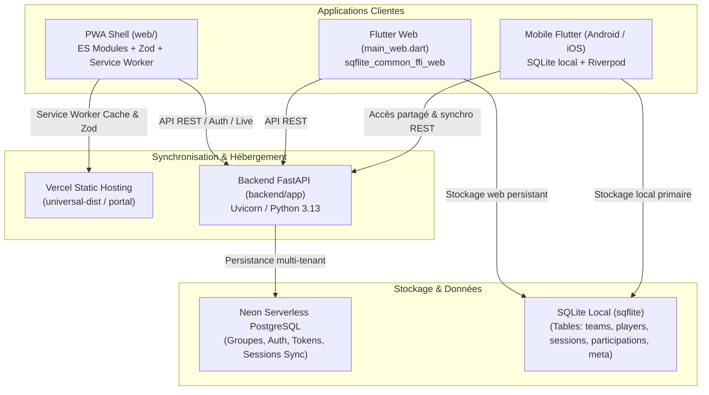

# Architecture Globale Statoo

État constaté au 30 octobre 2026.

## Vue d'ensemble du Système

Statoo est structuré en monorepo multi-environnements avec un domaine sportif et financier partagé entre application mobile (Flutter), application Web/PWA (Flutter Web + Shell ES Modules Zod) et une API Backend centralisée (FastAPI/SQLAlchemy/PostgreSQL).



---

## 1. Architecture Applicative Mobile (`mobile/lib/`)

Architecture **Feature-First** inspirée de Clean Architecture avec isolation stricte du domaine métier :

```
mobile/lib/
├── core/
│   ├── data/          # AppDatabase (singleton SQLite, vues SQL)
│   ├── domain/        # Interfaces génériques (StatooRepository)
│   ├── router/        # GoRouter (StatefulShellRoute indexedStack 5 onglets)
│   ├── theme/         # AppTheme (clair/sombre), AppColorsExtension, Poppins
│   └── widgets/       # Composants partagés (AppCard, PrimaryButton, StatusBadge...)
└── features/
    ├── home/          # Synthèse d'accueil, raccourcis, classements express
    ├── onboarding/    # Introduction et aiguillage initial
    ├── team/          # Gestion multi-tenant, création, switcher de groupe
    ├── players/       # Gestion effectif, fiches joueurs, archivage (is_active)
    ├── sessions/      # Préparation, composition, matchs, buts/passes, clôture
    ├── ranking/       # Classement général, ratio victoires, MVP mensuel
    ├── stats/         # Vues statistiques du groupe et bilans
    ├── finance/       # Trésorerie, cotisations, points financiers
    ├── settings/      # Réglages groupe, backup/restore JSON
    └── shared/        # Gestion accès collectif et accès managers en ligne
```

### Règle de dépendance des couches :
1. **Domain** : Entités `freezed`, calculs purs, aucune dépendance Flutter ni Riverpod.
2. **Data** : Repositories SQLite (`sqflite`), persistance, sérialisation.
3. **Application** : Providers Riverpod, Notifiers d'état, contrôleurs avec invalidation explicite.
4. **Presentation** : Widgets UI, écrans, bottom sheets, adaptation responsive et thème.

---

## 2. Modèle de Données (SQLite Local & Backend)

### SQLite Mobile (`mobile/lib/core/data/app_database.dart`) :
- `teams` : `id`, `name`, `short_name`, `created_at`, `color_theme`, etc.
- `players` : `id`, `team_id`, `name`, `number`, `avatar_color`, `is_active`, `created_at`.
- `sessions` : `id`, `team_id`, `played_at`, `status` (`DRAFT`, `CLOSED`, `CANCELLED`), `split_mode`, `session_type` (`classic`, `tournament`), `is_ranked`, `score_a`, `score_b`, `score_c`, `wins_a`, `wins_b`, `wins_c`, `result`.
- `participations` : `id`, `session_id`, `player_id`, `team_side` (`A`, `B`, `C`), `goals`, `assists`, `yellow_cards`, `red_cards`. **Seule source de vérité statistique.**
- `meta` : Paires clé/valeur pour l'état d'application (notamment `active_session_id_<teamId>`).
- **Vues SQL calculées** :
  - `v_player_match_results`
  - `v_standings`
  - `v_standings_per_match`
  - `v_top_scorers`, `v_top_assists`, `v_top_cards`
  - `v_group_totals`

### PostgreSQL Backend (`backend/app/models.py`) :
- `groups` : Groupes enregistrés avec codes de liaison et métadonnées.
- `tokens` : Sessions authentifiées avec expiration et rôles (ADMIN, PDT, VP, TR, TGA, SG, SGA, CENSOR, MEMBER).
- `registration_operations` : Idempotence des créations de groupes et des adhésions.
- Points financiers et sessions sportives synchronisées.

---

## 3. Flux Principaux

### 3.1 Démarrage de l'application
1. Initialisation des bindings et lecture des SharedPreferences (`main.dart`).
2. Détection du groupe actif dans SQLite.
3. Injection des états dans `ProviderScope` (`hasSeenOnboarding`, `hasExistingTeam`, `activeTeamId`).
4. Routage via `GoRouter` :
   - `/splash` -> redirection `/onboarding` (si 1ère fois) -> `/creer-equipe` (si aucun groupe) -> `/` (accueil).

### 3.2 Cycle de vie d'une séance de foot
1. **Création (`/seances/nouvelle`)** : Choix date, match classé/amical, effectif, tirage au sort ou manuel des équipes (A/B ou tournoi A/B/C), couleurs et noms personnalisés.
2. **Démarrage match** : Sauvegarde en `DRAFT` et assignation `active_session_id_<teamId>` dans `meta`.
3. **Pendant le match** : Saisie des scores, attribution des buts aux buteurs, passes décisives, cartons.
4. **Clôture** : Validation par `SessionCloseRules` (contrôles stricts de cohérence), bascule du statut à `CLOSED`, calcul des points de classement, suppression du pointeur actif dans `meta`, invalidation de tous les providers dérivés (`rankingProviders`, `statsProviders`).

### 3.3 Synchronisation Web & Mobile (Parité)
- Le pont de synchronisation supporte l'export/import du wire format sport et finance compatible entre SQLite local et l'API distante.
- En mode hors-ligne, les brouillons sont conservés localement avec identifiant d'opération idempotent pour rejeu automatique dès reconnexion.
