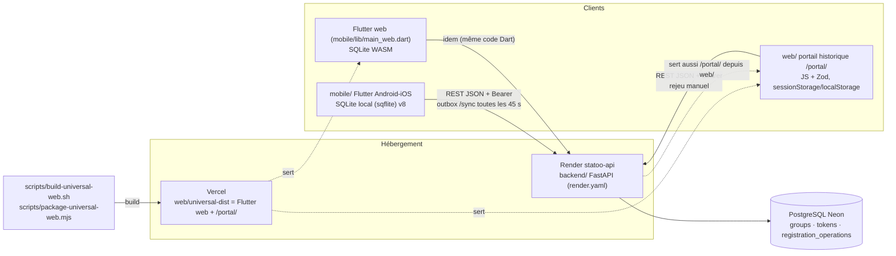

# Vue d'ensemble : applications et échanges

État constaté le 14/11/2026 sur `staging` (`2a9a3c7`). Ce document complète [`docs/ai/ARCHITECTURE.md`](../ai/ARCHITECTURE.md). Le détail par application se trouve dans [`mobile/docs/architecture/analyse.md`](../../mobile/docs/architecture/analyse.md), [`backend/docs/architecture/analyse.md`](../../backend/docs/architecture/analyse.md) et [`web/docs/architecture/analyse.md`](../../web/docs/architecture/analyse.md). Les déductions sont marquées **[déduit]**.

`statoo-5v5` est **un seul dépôt git (monorepo)**, et non un ensemble de dépôts indépendants.

## Schéma

- **Mobile et Flutter web.** Ils fonctionnent d'abord **en local** (SQLite). L'API n'intervient que pour un « groupe partagé » : comptes, rôles, synchronisation versionnée et finances.
- **Backend.** Il stocke chaque groupe comme **un agrégat JSON** (`groups.state`). Il n'a ni tables métier ni migrations.
- **Adresse de l'API.**
  - Flutter : constante de compilation `STATOO_API`, par défaut `https://statoo-api.onrender.com`.
  - Portail : `config.json`, rempli à partir de `STATOO_PUBLIC_API_URL`.

## Contrats entre applications (étape 4)

Il n'existe **aucun contrat formel partagé** : pas de package commun, pas de client généré depuis l'OpenAPI (`/openapi.json` existe mais n'est pas exploité), pas de versioning d'API. Le seul artefact partagé est le fixture `web/tests/fixtures/mobile-snapshot.json`. Il est produit par `web/tests/export-mobile-fixture.mjs` et lu par `mobile/test/features/shared/pwa_wire_import_test.dart` et `web/tests/domain.test.mjs`.

### Endpoints par client

| Endpoint (backend/app/main.py) | Mobile / Flutter web | Portail web |
|---|---|---|
| `POST /groups`, `POST /auth/login`, `POST /auth/logout`, `GET /groups/{g}`, `POST /groups/{g}/sync` | ✔ | ✔ |
| `POST /groups/{g}/accounts`, `PUT …/accounts/{id}/roles`, `PUT …/members` | ✔ | ✔ |
| `POST …/opening`, `…/opening/approve`, `…/documents/{d}/{o}/resolve`, `…/transfer`, `PUT …/financial-settings` | ✔ | ✔ |
| `POST /auth/recover` | ✔ | ✘ |
| `POST …/accounts/{id}/password` et `…/password/verify`, `POST …/shared-access/verify` | ✔ | ✘ |
| `PUT …/shared-access` (rotation de l'accès collectif) | ✘ | ✔ |
| `PUT …/sport-settings` (minimum de joueurs) | ✘ (lecture seule via le snapshot, `shared_service.dart:752`) | ✔ |
| `POST …/account/password` (ACCESS-03), `PUT …/account/recovery-code` (régénération) | ✘ | ✘ |

### Source qui fait foi, par contrat

| Contrat | Source de vérité | Copies et divergences |
|---|---|---|
| Endpoints, codes d'erreur, droits | `backend/app/main.py` | Mobile `shared_service.dart`, portail `web/client.mjs`. Le format d'erreur est incohérent : `detail` est une chaîne, sauf pour un 409 `active_session_conflict` où c'est un objet. |
| Matrice rôles × domaines | `backend/app/main.py:30-33` | Copiée dans `mobile/lib/features/shared/data/shared_service.dart:39-49`, `shared_group_screen.dart:896-898` et `web/domain.mjs:41-51` |
| Règles sport (équilibre, minimum, résultat, buts) | **Backend à la synchro**, mobile pour l'usage local | Trois implémentations : `session_close_rules.dart`, `validate_sport` (main.py:903-993) et `web/domain.mjs:83-173`. Seul le format d'échange est couvert par un fixture commun. |
| Points de classement et départage | Vues SQLite mobile (`app_database.dart`) | `web/summary.mjs` ; `stats_calculator.dart`, utilisé uniquement en test |
| Format filaire d'une séance (lignes SQLite) | Schéma SQLite mobile v8 | Le backend valide un sous-ensemble et stocke le reste sans contrôle (`payload` libre) |
| Statut `CANCELLED` | Protocole de synchro (backend, web, `shared_service.dart`) | Interdit par le `CHECK` SQLite mobile. À l'import, il est traité à part (`shared_service.dart:939`). |
| `min_players_per_session` | Partagé : `sport_settings` côté serveur ; local : `meta` | Le mobile ne peut pas le modifier sur le serveur, seul le portail le peut [déduit d'après la liste des appels] |
| Points financiers | Partagé : documents `finance:*` + `obligations` côté serveur | Mobile : JSON dans `meta` (`finance_point_*`), sans table |

### Incohérences signalées

1. **Fonctions ACCESS sans client.** Le changement de son propre mot de passe (ACCESS-03) et la régénération du code de récupération n'ont aucun appelant, ni dans le mobile ni dans le portail.
2. **Portail en retard.** Le portail n'a ni récupération, ni changement de mot de passe, ni gestion des co-admins. Pourtant, il est toujours livré sur Vercel et sur l'API.
3. **Deux politiques de file d'attente.** Le mobile rejoue automatiquement et ajoute les statuts `blocked`, `rejected` (avec 404/410). Le portail rejoue manuellement et supprime l'opération sur 400/403/409/422.
4. **Défaut d'URL d'API = production**, dans le code Flutter et dans le script de build. Un build local ou un test e2e sans `--dart-define` parle à la production.
5. **Dette serveur.** `resolve` n'applique pas la mise à jour des `obligations` faite par `/sync` (bug confirmé par lecture, `backend/app/main.py:820` vs `827-858`).

### Ce qui devrait être partagé [proposition]

- Un schéma de contrat unique : OpenAPI exporté, ou fixtures JSON par endpoint, vérifié par les trois suites de tests.
- Une table de règles métier commune, ou des fixtures de scénarios (entrée → verdict), exécutée par Dart, Python et JS.
