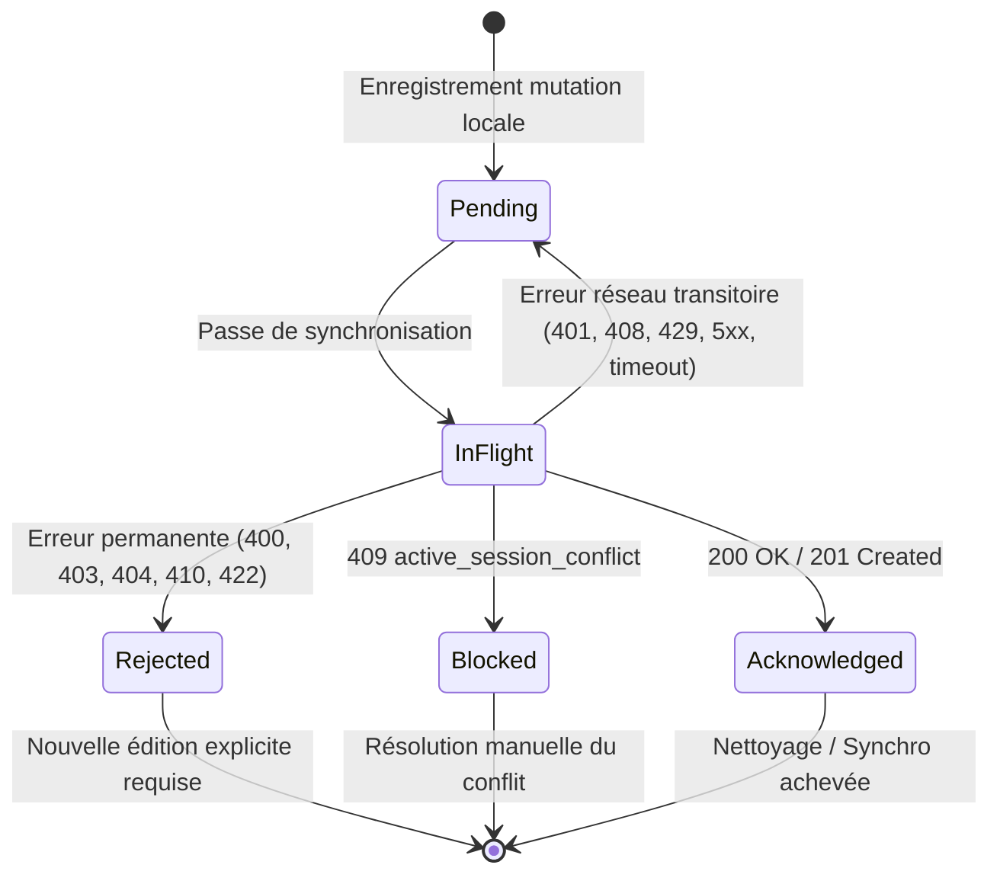

# Mécanisme de Synchronisation Outbox et Rejeu Hors-Ligne

Ce document formalise le fonctionnement de la file de synchronisation asynchrone (Outbox) et des règles de retry hors-ligne appliquées dans Statoo (référence de conception : lot F05).

---

## 1. Principes Directeurs

1. **Priorité Locale (Offline-First)** : L'application mobile Flutter et la PWA fonctionnent de manière autonome en mode déconnecté. Toutes les écritures locales (compositions d'équipe, scores de match, cotisations) sont immédiatement validées et persistées dans SQLite local.
2. **Idempotence Stricte** : Chaque mutation locale vers le serveur est identifiée par un triplet immuable :
   - `domain` : `'sport'` ou `'finance'`
   - `occurrence_id` : identifiant stable du document (ex: `session_id`)
   - `operation_id` : UUID unique de la tentative de publication
3. **Isolation des Échecs** : Un refus ou une erreur sur une séance donnée ne doit jamais bloquer la transmission des autres séances ou opérations financières indépendantes.

---

## 2. Machine à États d'une Opération Outbox

---

## 3. Matrice des Erreurs et Règles de Rejeu (F05 / QUE01 à QUE10)

| Code HTTP / Condition | Statut Outbox | Action Client | Règle de Rejeu |
|---|---|---|---|
| **200 OK / 201 Created** | `acknowledged` | Opération validée par le serveur. Mise à jour de la révision locale. | Retirée de la file outbox. |
| **Coupure réseau / Timeout / 5xx / 429 / 408** | `pending` | L'erreur est mémorisée (`syncWarning`). La passe s'arrête pour éviter de saturer le serveur. | Rejeu automatique à la prochaine passe ou reconnexion avec le même `operation_id`. Aucun rejeu immédiat en boucle. |
| **401 Unauthorized** | `pending` | Token expiré ou absent. Avertissement affiché ; pas de destruction de la file locale. | Rejeu différé après ré-authentification de l'utilisateur. |
| **400 / 403 / 404 / 410 / 422** | `rejected` | Refus définitif de validation métier ou droits insuffisants. Statut, code et message d'erreur persistés. | **Aucun rejeu automatique.** Les documents indépendants continuent leur synchronisation. L'utilisateur doit corriger explicitement sa saisie. |
| **409 active_session_conflict** | `blocked` | Une autre séance est déjà activement déclarée sur le serveur pour ce groupe. | **Aucun rejeu automatique.** L'état bloque cette séance spécifique pour éviter d'écraser les données distantes. |

---

## 4. Garanties de Sécurité et Multi-Tenant

- **Cloisonnement par Groupe (`team_id`)** : Chaque opération outbox est explicitement liée au `team_id` actif. Aucune opération d'un groupe ne peut fuiter ou impacter la file d'un autre groupe.
- **Cloisonnement par Auteur** : Les opérations sont partitionnées par auteur. Le rejet permanent de la saisie d'un utilisateur n'altère pas la publication des autres membres du groupe.
- **Déconnexion sécurisée** : Une réponse réseau tardive arrivant après la déconnexion locale de l'utilisateur ne modifie ni l'état SQLite local ni les identifiants sécurisés (Tokens).

---

## 5. Résilience de la Base de Données Mobile (SQLite)

- **Cycle de vie applicatif (`AppLifecycleObserver`)** :
  - Lors de la mise en arrière-plan (`AppLifecycleState.paused`) ou fermeture (`detached`), la connexion SQLite est fermée proprement via `AppDatabase.instance.close()`.
  - Au retour au premier plan (`resumed`), la réouverture s'effectue automatiquement et de manière transparente dès le premier appel à `AppDatabase.instance.database`.
- **Auto-guérison des Vues SQL (`_ensureViews`)** :
  - Les 7 vues d'agrégation statistique (`v_standings`, `v_top_scorers`, etc.) sont vérifiées à l'ouverture directement dans `sqlite_master`.
  - Si une vue manque ou a été altérée, elle est recréée immédiatement de façon idempotente, assurant une disponibilité 100% sans perte de données.
