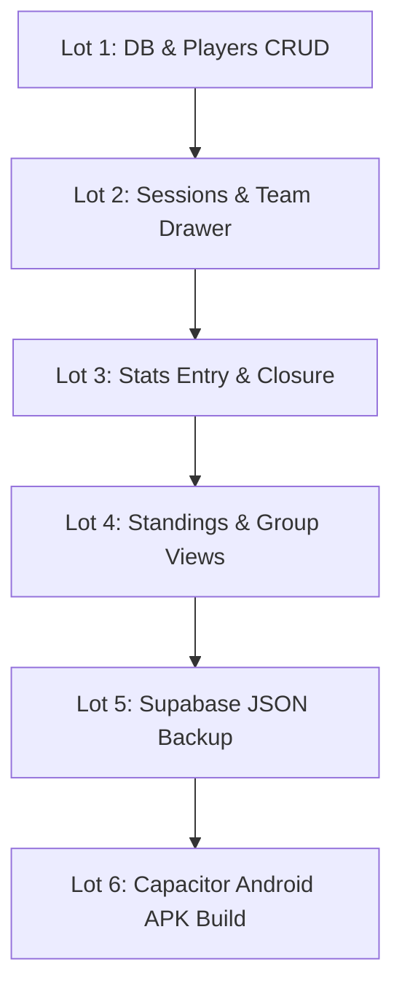

# Statoo — Functional Specifications Index

This directory contains the detailed technical and functional specifications for **Statoo**, broken down by feature domain from [docs/statoo-cahier-des-charges.md](file:///c:/Users/ky-solutions/projects/persos/statoo%205v5/docs/statoo-cahier-des-charges.md).

## Specification Documents & Status Matrix

| Spec ID | Document Title | Target Lot | Status | Primary Component / Module |
|---|---|---|---|---|
| **SPEC-01** | [Database Core & Migrations](file:///c:/Users/ky-solutions/projects/persos/statoo%205v5/specs/spec-01-database-core.md) | **L1** | 📝 DRAFT | `lib/db/`, `composables/useDb.ts` |
| **SPEC-02** | [Players Management](file:///c:/Users/ky-solutions/projects/persos/statoo%205v5/specs/spec-02-players.md) | **L1** | 📝 DRAFT | `pages/players/`, `composables/usePlayers.ts` |
| **SPEC-03** | [Sessions & Team Composition](file:///c:/Users/ky-solutions/projects/persos/statoo%205v5/specs/spec-03-sessions-composition.md) | **L2** | 📝 DRAFT | `pages/sessions/`, `lib/splitter/` |
| **SPEC-04** | [Match Stats & Session Closure](file:///c:/Users/ky-solutions/projects/persos/statoo%205v5/specs/spec-04-match-stats-closure.md) | **L3** | 📝 DRAFT | `pages/sessions/[id]/`, `composables/useSessions.ts` |
| **SPEC-05** | [Standings & Group Statistics](file:///c:/Users/ky-solutions/projects/persos/statoo%205v5/specs/spec-05-standings-stats.md) | **L4** | 📝 DRAFT | `pages/standings/`, `pages/stats.vue` |
| **SPEC-06** | [Backup & Restoration](file:///c:/Users/ky-solutions/projects/persos/statoo%205v5/specs/spec-06-backup-restore.md) | **L5** | 📝 DRAFT | `lib/backup/`, `composables/useBackup.ts` |
| **SPEC-07** | [Design System & UI Components](file:///c:/Users/ky-solutions/projects/persos/statoo%205v5/specs/spec-07-design-system-ui.md) | **L1-L6** | 📝 DRAFT | `assets/css/`, `components/ui/` |
| **SPEC-08** | [First Launch, Onboarding & Settings](file:///c:/Users/ky-solutions/projects/persos/statoo%205v5/specs/spec-08-onboarding-settings.md) | **L1** | 📝 DRAFT | `pages/onboarding/`, `composables/useSettings.ts` |
| **SPEC-09** | [PWA Delivery & iOS Installability](file:///c:/Users/ky-solutions/projects/persos/statoo%205v5/specs/spec-09-pwa-delivery.md) | **L6b** | 📝 DRAFT | `nuxt.config.ts`, `scripts/generate-icons.cjs` |

---

## Delivery Lots Mapping (Roadmap)

1. **L1 — Core DB & Players**: Local SQLite initialization, views setup, `settings` table & onboarding (SPEC-08), Player creation, editing, active/archive management, search.
2. **L2 — Sessions & Composition**: Session draft creation, date/time picker, attendee selection, `RandomSplitter` (Fisher-Yates) team draw, manual adjustments.
3. **L3 — Stats & Closure**: Score input, individual player `StatStepper` inputs (goals, assists, cards), unassigned goals, validation rules, closure & reopening.
4. **L4 — Standings & Group Stats**: Standings table (Points & Pts/match with 50% eligibility threshold), secondary rankings (buteurs, passeurs, cartons), group totals.
5. **L5 — Backup & Restore**: JSON snapshot generation, Supabase Storage integration, auto-backup after closure, offline retry queue, destructive restore.
6. **L6 — Packaging & Verification**, two delivery channels:
   - **L6a — Android APK**: Capacitor build, native SQLite plugin test on Android, offline end-to-end verification.
   - **L6b — iOS PWA** (SPEC-09): manifest, service worker, home-screen install from Safari. The only route to iOS without the App Store.

---

## Standard Spec Document Plan Structure

Each specification file follows this standardized structure:
1. **Title & Metadata**
2. **Context & Goals**
3. **Domain Rules & Invariants**
4. **Data Specification & Types**
5. **UI / UX Specifications**
6. **Technical Implementation Plan**
7. **Edge Cases & Error Handling**
8. **Verification & Testing Plan**
